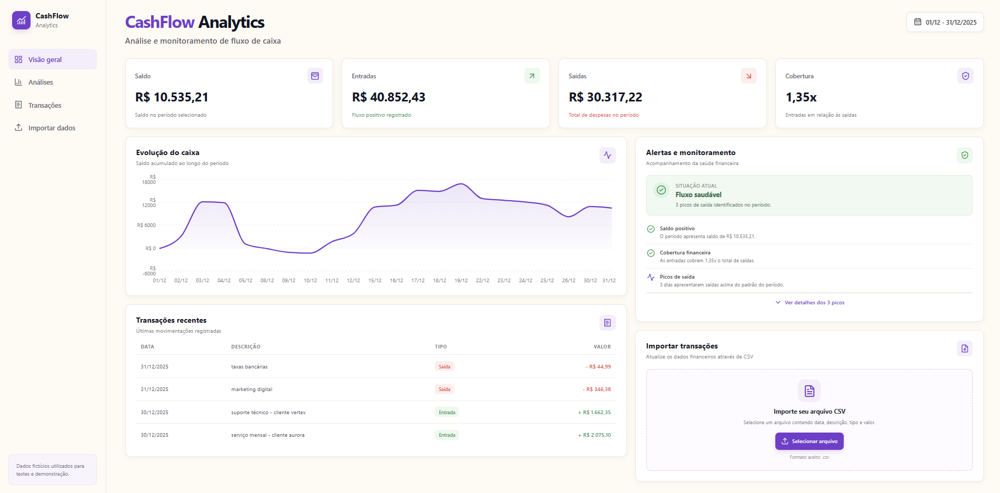
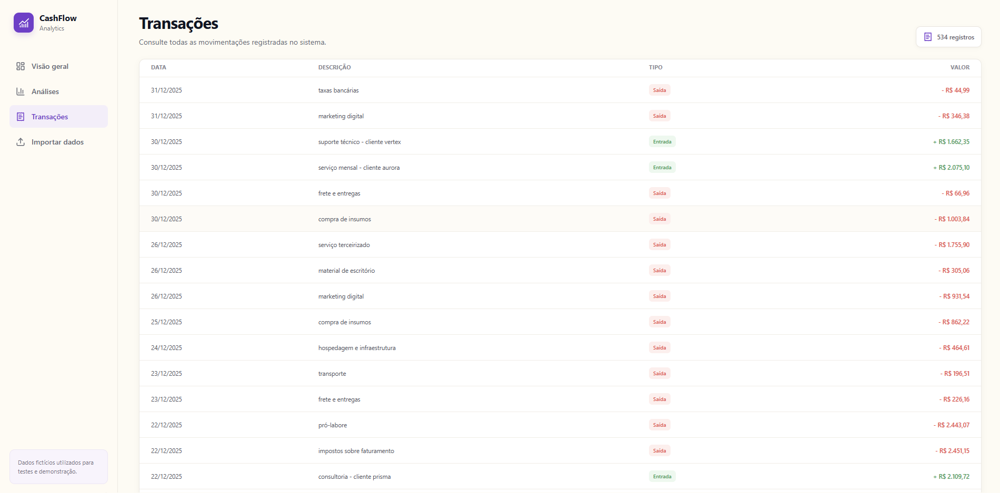
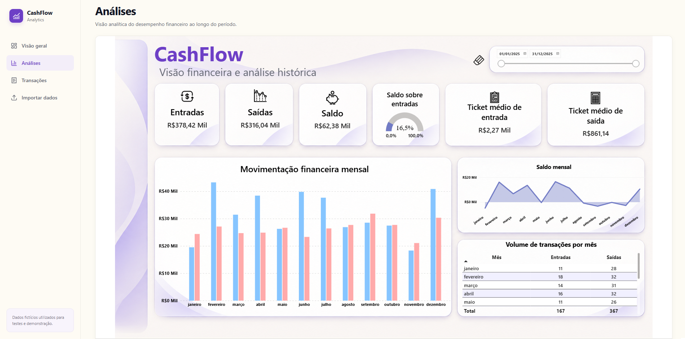

# CashFlow Analytics

**Análise e monitoramento de fluxo de caixa**

O CashFlow Analytics é um projeto de portfólio desenvolvido para demonstrar o uso integrado de desenvolvimento web, processamento de dados, bancos de dados relacionais e Business Intelligence na análise financeira de uma empresa.

A aplicação permite importar transações financeiras, acompanhar indicadores de fluxo de caixa, consultar movimentações e identificar situações que merecem atenção.


## Demonstração

### Dashboard financeiro



### Consulta de transações



### Análises no Power BI



### Importação de arquivos CSV


## Funcionalidades

- **Dashboard financeiro:** visualização de entradas, saídas, saldo e cobertura financeira.
- **Análise temporal:** acompanhamento do fluxo de caixa e do saldo acumulado ao longo do período selecionado.
- **Monitoramento financeiro:** alertas para saldo negativo, saídas superiores às entradas e despesas diárias significativamente acima da média.
- **Importação de CSV:** envio de arquivos com transações financeiras, validação dos dados e identificação de possíveis duplicidades.
- **Consulta de transações:** listagem paginada e filtragem das movimentações por período.
- **Power BI:** painel complementar com indicadores e análises financeiras.
- **Testes automatizados:** testes com `pytest` para verificar partes importantes do processamento e das regras do sistema.

## Tecnologias utilizadas

| Tecnologia | Aplicação no projeto |
|---|---|
| Python | Processamento e regras de negócio |
| FastAPI | Desenvolvimento da API |
| PostgreSQL | Armazenamento dos dados |
| SQL | Consultas e agregações financeiras |
| Pandas | Leitura e validação de arquivos CSV |
| React e JavaScript | Interface web |
| Vite | Ambiente de desenvolvimento do frontend |
| Recharts | Gráficos da aplicação |
| Power BI | Análises e visualização de indicadores |
| DAX e Power Query | Medidas e preparação de dados no Power BI |
| Pytest | Testes automatizados |

## Como funciona

O sistema é organizado em três partes principais:

1. **Frontend:** interface em React responsável por apresentar os indicadores, gráficos, transações, alertas e funcionalidades de importação.
2. **Backend:** API em FastAPI que recebe as solicitações, valida as datas, executa as regras de negócio e consulta o banco de dados.
3. **Banco de dados:** PostgreSQL, responsável por armazenar as empresas e suas transações financeiras.

O fluxo de importação começa com o envio de um arquivo CSV pela interface. O backend valida e normaliza os dados, gera uma identificação baseada nas informações de cada transação e insere os registros no PostgreSQL, evitando a reimportação de registros reconhecidos como duplicados.

O Power BI complementa a aplicação com um painel analítico próprio.

## Indicadores financeiros

- **Entradas:** soma dos valores classificados como entradas no período.
- **Saídas:** soma dos valores classificados como saídas no período.
- **Saldo:** diferença entre entradas e saídas.
- **Cobertura:** relação entre entradas e saídas, indicando quanto as entradas representam em relação às saídas.
- **Saldo acumulado:** evolução do saldo conforme as movimentações registradas ao longo do período.

Os alertas são baseados em regras determinísticas. Eles não representam previsões feitas por inteligência artificial.


## Estrutura do projeto

```text
CashFlow-Analytics/
├── backend/
│   ├── main.py
│   ├── database.py
│   ├── services.py
│   └── alertas.py
├── data/
│   ├── tests/
│   ├── importar_csv.py
│   ├── importador.py
│   ├── normalizar.py
│   ├── validar.py
│   ├── gerar_fingerprints.py
│   └── gerar_dados_demo.py
├── database/
│   └── schema.sql
├── docs/
│   └── images/
│       ├── dashboard-corrigido.png
│       ├── transacoes.png
│       ├── powerbi.png
│       └── importacao.png
├── frontend/
│   ├── src/
│   └── package.json
├── .gitignore
├── requirements.txt
└── README.md
```
  
## Como executar localmente

### Pré-requisitos

- Python 3.10 ou superior.
- Node.js e npm.
- PostgreSQL.
- Git.


### 1. Baixe o projeto

```bash
git clone https://github.com/luif-pedro/CashFlow-Sentinel.git
cd CashFlow-Sentinel
```


### 2. Configure o banco de dados

No PostgreSQL, crie um banco chamado `CashFlow` e execute o script `database/schema.sql` conectado a esse banco.

Em seguida, em um banco recém-criado, cadastre a empresa demonstrativa:

```sql
INSERT INTO empresas (nome)
VALUES ('Empresa Teste');
```

O MVP utiliza atualmente o identificador `empresa_id = 1`.

### 3. Configure as variáveis de ambiente

Crie um arquivo chamado `.env` na raiz do projeto, no mesmo nível de `requirements.txt`:

```env
DB_HOST=localhost
DB_PORT=5432
DB_NAME=CashFlow
DB_USER=postgres
DB_PASSWORD=sua_senha_local
```

Substitua `sua_senha_local` pela senha configurada no seu PostgreSQL. Não compartilhe nem publique esse arquivo.

### 4. Instale as dependências do backend

No terminal, na raiz do projeto:

```bash
python -m venv .venv
```

No Windows PowerShell, ative o ambiente virtual:

```powershell
.\.venv\Scripts\Activate.ps1
```

Instale as dependências:

```bash
python -m pip install -r requirements.txt
```

Inicie a API:

```bash
python -m uvicorn backend.main:app
```

A API estará disponível em `http://localhost:8000`. A documentação interativa pode ser acessada em `http://localhost:8000/docs`.

### 5. Instale e execute o frontend

Abra um segundo terminal:

```bash
cd frontend
npm install
npm run dev
```

A interface estará disponível em `http://localhost:5173`.

Mantenha os terminais do backend e do frontend abertos enquanto utiliza a aplicação.

### 6. Execute os testes

Na raiz do projeto, com o ambiente virtual ativado:

```bash
python -m pytest
```

Para verificar a compilação do frontend, em um terminal dentro da pasta `frontend`:

```bash
npm run build
```

## Dados de demonstração

O projeto inclui um conjunto de transações financeiras fictícias referentes a 2025, utilizado para testar a importação, os indicadores, os gráficos e as regras de monitoramento.

Para carregar os dados em uma instalação local, abra a aplicação, acesse a funcionalidade de importação e selecione o arquivo `data/transacoes_demo_2025.csv`.

Os dados são sintéticos e não representam uma empresa real.

## Limitações atuais

- O MVP está configurado para uma única empresa demonstrativa.
- A importação de dados é feita por arquivos CSV; integrações bancárias não fazem parte do escopo atual.
- A identificação de duplicidades utiliza empresa, data, descrição, tipo e valor. Transações legítimas idênticas nesses campos podem ser reconhecidas como duplicadas.
- Os alertas utilizam critérios definidos no código, e não modelos preditivos.
- A exibição do relatório incorporado do Power BI depende da configuração de publicação e de acesso ao relatório.

**Segurança:** como o relatório do Power BI utiliza publicação pública, devem ser utilizados apenas dados fictícios ou informações que possam ser divulgadas publicamente.
